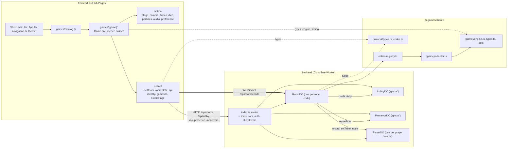
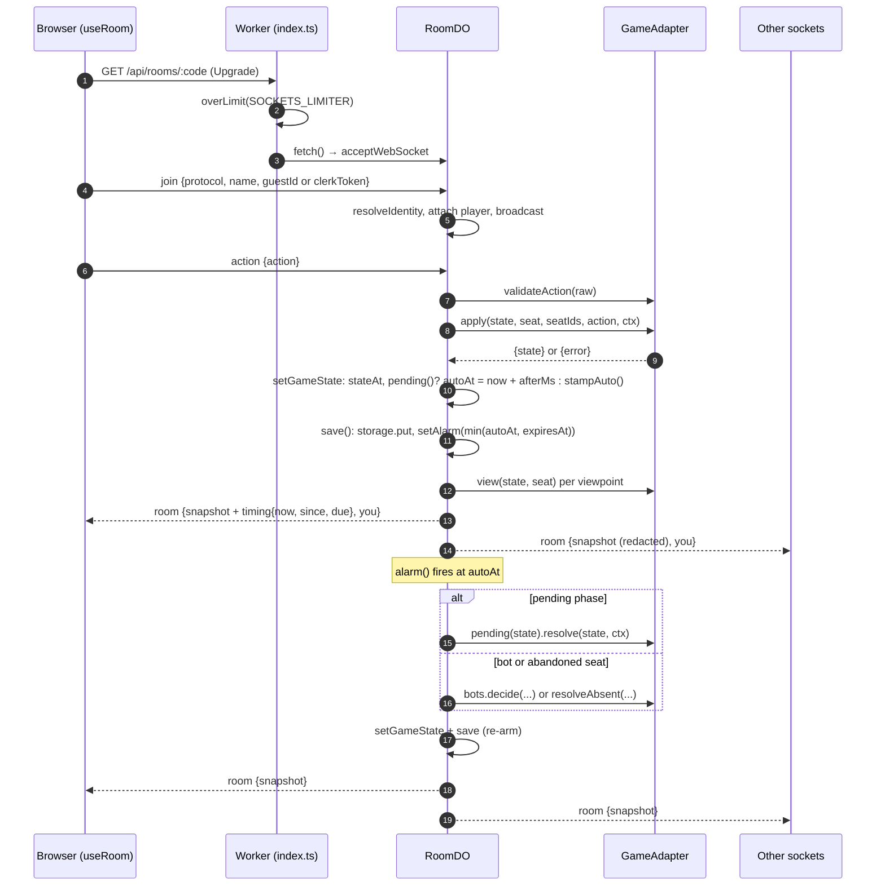

# Architecture

How the site fits together: a static React site on GitHub Pages, a Cloudflare Worker with Durable Objects
for rooms, and one package of game rules both of them import. Every game, including a game against bots,
runs in a server room; the browser renders and sends decisions, and never plays a seat itself.

For setup, secrets and local development see [deployment.md](./deployment.md). Older design notes live in
[docs/superpowers](./superpowers/) and `frontend/docs/superpowers/`; where they disagree with this file,
the code wins.

## Packages

npm workspaces (root `package.json`): `frontend`, `backend`, `shared`.

| Package         | What it is                                                                            | Key entry points                                                   |
| --------------- | ------------------------------------------------------------------------------------- | ------------------------------------------------------------------ |
| `frontend`      | React 19 + Vite 8 + Three.js site, served from GitHub Pages                           | `src/main.tsx`, `src/App.tsx`, `src/games/catalog.ts`              |
| `backend`       | Cloudflare Worker (`games-api`) with `RoomDO`, `LobbyDO`, `PresenceDO`, `PlayerDO`    | `src/index.ts`, `src/room.ts`, `wrangler.jsonc`                    |
| `@games/shared` | Pure game engines, room adapters and the wire protocol, imported as TypeScript source | `package.json` `exports`, `src/online/registry.ts`, `src/protocol` |

The frontend never imports `@games/shared/online` (the registry): that would pull every game's rules into
the bundle (see the comment in `shared/src/online/registry.ts`). It imports engines, types and timing
helpers per game, e.g. `@games/shared/wildrise/timing`.

## Frontend shell

### Entry and routing

- `frontend/src/main.tsx` renders `ThemeProvider` → `AuthProvider` → `unstable_HistoryRouter` (with
  `useTransitions={false}`) → `App`. It also imports `motion/preference` first so `<html data-motion>` is
  set before paint, calls `installErrorReporting()`, and reloads once on `vite:preloadError` (guarded by
  `sessionStorage['games-chunk-reload']`).
- Routing is hash-based (`#/chess`) so Pages needs no rewrites. `createAppHistory()` in
  `frontend/src/navigation.ts` builds the history from `UNSAFE_createHashHistory({ v5Compat: true })` and
  wraps `history.listen` so every navigation runs through `transition()`.
- **Why react-router is pinned:** `frontend/package.json` pins `react-router` to exactly `7.18.3` because
  the shell relies on two non-public exports (`UNSAFE_createHashHistory`, `unstable_HistoryRouter`). The
  comment above `createAppHistory()` lists what to verify before moving the pin, including
  `npx playwright test tests/routing.spec.ts`.
- Besides the games, `App.tsx` routes `/me` and `/player/:handle` to `pages/ProfilePage.tsx` (stats, chess
  rating, recent games, open tables, notification opt-in); the home page shows the same open tables as
  `pages/YourTables.tsx` and links the profile from a trophy button. `main.tsx` also registers the service
  worker (`online/serviceWorker.ts`, `public/sw.js`: caches the shell and hashed assets, same-origin only;
  shows push notifications and opens `#<path>` on click) behind `public/manifest.webmanifest`.
- `frontend/src/App.tsx` generates every route from `games` in `games/catalog.ts`: `/` (`HomePage`), each
  game's `path`, its `aliases` (as `<Navigate replace>`), `${path}/room/:code` for entries with
  `online: true` (all five), and `*` → `/`. It also sets the document title, description, favicon and
  `theme-color` per game, and wraps everything in `PlayersOnlineProvider`, `ChunkErrorBoundary` (keyed by
  pathname) and `Suspense` with `RouteSkeleton`.
- `screenOf(pathname)` in `navigation.ts` maps a path to `{ game, room }`; it drives the skeleton, the
  metadata and the transition kind.

### Lazy chunks

- `lazyWithPreload()` (`frontend/src/lazyPreload.ts`) is `React.lazy` plus `preload()`. Once a chunk is
  loaded it renders synchronously, so a `flushSync` inside a view transition never photographs the
  skeleton.
- Catalog entries spread `lazyWithPreload(() => import(...))`; `HomePage` calls `game.preload()` on
  pointer-enter and focus. `roomPage` (the shared `online/RoomPage.tsx`) is preloaded the same way.
- Vite puts Three.js in its own `three` chunk (`frontend/vite.config.ts`) so its hash survives deploys that
  only touch a game. React Compiler runs through `@rolldown/plugin-babel`.

### View transitions

`viewTransition(kind, apply, { prepare, after })` in `navigation.ts` wraps `document.startViewTransition`,
tags `<html data-vt=kind>` for `index.css`, and commits `apply` with `flushSync`. `canTransition()` skips it
without browser support, under reduced motion, in hidden tabs, or while another transition is updating.

| Kind    | Where                                               | Effect                                                        |
| ------- | --------------------------------------------------- | ------------------------------------------------------------- |
| `open`  | home → game, from a visible `.collection-card-<id>` | card grows into the page (`view-transition-name: game-stage`) |
| `close` | game → home                                         | page folds back into its card                                 |
| `swap`  | other screen changes; `useRoom` lobby ↔ table       | cross-fade; `prepare` waits up to 400 ms for chunks           |
| `theme` | `ThemeControl` appearance change                    | circular reveal from the control                              |

### Pages and theme

- `pages/HomePage.tsx` is the collection: one card per catalog entry with a CSS `BoardPreview`
  (`ChessPreview.css`, `PrismPreview.css`, `WildrisePreview.css`), `PlayersOnlineBadge`, `ThemeControl`
  and `HeaderAuth`.
- `theme/ThemeProvider.tsx` stores `system | light | dark` in `localStorage['games-appearance']`, resolves
  `system` with `prefers-color-scheme`, writes `<html data-theme>` and `color-scheme`, and syncs across tabs
  via the `storage` event. An inline script in `frontend/index.html` applies the saved theme before first
  paint. `theme/ThemeControl.tsx` is the header control for appearance, plus the motion and haptics
  preferences.

## Motion toolkit (`frontend/src/motion`)

Shared by all five games' scenes. Everything runs off the stage's clock rather than its own
`requestAnimationFrame`, so pausing a stage (or the test clock) pauses all of it.

| Module          | Main exports                                                                                       |
| --------------- | -------------------------------------------------------------------------------------------------- |
| `stage.ts`      | `createStage`, `Stage`, `QualityTier`, `allowPageScroll`, `disposeTree`, `onTap`                   |
| `camera.ts`     | `createCameraRig`, `Shot`, `Orbit`                                                                 |
| `tween.ts`      | `createTweens`, `createQueue`, `Beat`                                                              |
| `dice.ts`       | `createDieThrow`                                                                                   |
| `particles.ts`  | `createParticles`, `qualityDensity`, `BurstKind` (`confetti`, `spark`, `dust`)                     |
| `ease.ts`       | easing curves, `damp`/`dampFactor`, `arc`, `squash`, `spring`/`stepSpring`, `hash01`, `hashString` |
| `audio.ts`      | `tone`, `noise`, `sounds`, re-exports `haptic`, `setHaptics`, `useHaptics`, `canVibrate`           |
| `haptics.ts`    | vibration with an on/off preference in `localStorage['games-haptics']`                             |
| `preference.ts` | `reducedMotion`, `useReducedMotion`, `useMotionPreference`, `onMotionChange`                       |
| `hooks.ts`      | `useCountUp`, `useHeld`                                                                            |

### Stage

`createStage(container, options)` owns the `WebGLRenderer`, a `RoomEnvironment` map, a `ResizeObserver`,
pixel-ratio tracking, WebGL context loss/restore and full disposal. The scene adds cameras and models.

- **Render-on-demand loop:** `onFrame(cb)` callbacks get `(dt, now)` and return `true` while moving; the
  stage draws only while something moves or after `invalidate()`. `dt` is capped at 1/20 s; the skipped
  wall time accumulates and is returned once by `takeDrift()`, which board scenes use to stay in step with
  the room.
- **Quality tiers:** `QualityTier` is `2` (full), `1` (pixel ratio 1.25), `0` (ratio 1, shadows off). Over
  about 2.5 s of animating frames, if more than 60% of that time is spent in frames over 22 ms, the
  stage steps down one tier and never back up during the visit. The tier persists in `sessionStorage['games-quality']`. `onQuality(cb)`
  lets a game thin its extras, e.g. `particles.density = qualityDensity(tier)`.
- **Picking:** `pick(event, objects)` raycasts; `ray(event)` returns the world ray for plane or box hits;
  `toScreen(point)` projects to CSS pixels; `onTap()` separates taps from orbit drags.
- `allowPageScroll(canvas)` sets `touch-action: pan-y` on coarse pointers after `OrbitControls` sets
  `none`, so phones can still scroll the page past the board.
- `setRunning(false)` freezes the clock and every `dt`.

### Camera, tweens, dice, particles

- `createCameraRig(camera, controls)` shares the camera with `OrbitControls` (or a bare `{ target }`):
  `to(shot)`, `orbit({ azimuth, polar, radius, swoop, ... })`, `follow(point)`, `shake()`, `step(dt)`. It
  yields for `yieldMs` (default 4000) after the viewer grabs the camera (`userControlled`).
- `createTweens()` gives `add({ duration, ease, update, done })`, `step(dtMs)`, `finishAll()`, plus a
  `speed` multiplier.
- `createQueue({ catchUpAfter, catchUpSpeed, countBy })` plays `Beat`s in order (`run()` returns how long
  to hold). With a backlog above `catchUpAfter`, `speed` rises to `catchUpSpeed`; `countBy: 'push'`
  counts one push per snapshot instead of per beat. `flush()` + `tweens.finishAll()` land the final state.
- `createDieThrow(die, options)` splits a roll into `shake()` (while waiting for the server) and
  `throw(value)` (ballistic toss landing on the server's face). Nothing is simulated.
- `createParticles(scene)` is one pooled `InstancedMesh` for all bursts.

### Audio, haptics, preference, test clock

- **One audio engine** (`audio.ts`): a single `AudioContext` woken by the first gesture, with a compressor
  and a generated reverb send. Games build their vocabulary in `games/<game>/game/audio.ts` from `tone`,
  `noise` and the `sounds` presets (`knock`, `thud`, `tick`, `pop`, `whoosh`, `chime`, `sparkle`,
  `fanfare`), keep their own mute toggle, and call `haptic()` for felt impacts.
- **Motion preference** (`preference.ts`): `system | full | reduced`, stored in
  `localStorage['games-motion']`, mirrored to `<html data-motion>` for CSS. Reduced motion shortens and
  softens animation rather than skipping it.
- **Hooks:** `useCountUp(value, ms, { from })` animates numbers (jumps under reduced motion);
  `useHeld(when, ms)` delays a flag, e.g. a win dialog until the celebration plays.
- **Test clock:** with `localStorage['games-test-clock'] = 'on'` at load, `stage.ts` installs
  `window.__motionClock` with `freeze()`, `step(ms)` (advances every stage in 1/60 s slices; returns a
  promise) and `release()`. Running free under it, every frame is exactly 1/60 s. The `*-motion.spec.ts`
  Playwright specs use it to photograph mid-animation frames.

## Online layer (`frontend/src/online`)

| File                                     | Role                                                                                                                                                                             |
| ---------------------------------------- | -------------------------------------------------------------------------------------------------------------------------------------------------------------------------------- |
| `api.ts`                                 | `API_URL` (`VITE_API_URL`, default `http://127.0.0.1:8787`), `createRoom`, `fetchLobby`, `roomSocketUrl`, `presenceBeat`                                                         |
| `guest.ts`                               | `guestId()` (UUID in `localStorage['games-guest-id']`), `guestName()`, `saveGuestName()`                                                                                         |
| `identity.tsx`, `clerkAuth.tsx`          | `AuthProvider`, `useIdentity()`, `HeaderAuth`; Clerk loads lazily only when `VITE_CLERK_PUBLISHABLE_KEY` is set                                                                  |
| `useRoom.ts`                             | the room WebSocket and `RoomApi`                                                                                                                                                 |
| `roomState.ts`                           | `roomReducer`, `RoomClientState`, `SnapshotEntry`, `RECENT_SNAPSHOTS`, `presenceEvents`                                                                                          |
| `games.ts`                               | `RoomViewProps`, `BotSkill`, per-game `CONFIGS`, `onlineGame(id)`                                                                                                                |
| `RoomPage.tsx`                           | the shared room page: name prompt, waiting room (seats, bots, start), then the game's `RoomView`                                                                                 |
| `useBotRoom.ts`                          | "Play vs bot": creates a private room with `bots` and `autoStart: true`, then navigates to it                                                                                    |
| `PlayOptions.tsx`, `OnlinePanel.tsx`     | setup UI shared by game menus (bot tab vs create/join/lobby)                                                                                                                     |
| `useMe.ts`, `api.ts` `fetchMe`           | the player's own profile from `GET /api/me` (credentials as `Authorization: Bearer` or `X-Guest-Id` headers, never the URL)                                                      |
| `ReactionBar.tsx`, `ReactionOverlay.tsx` | six fixed reactions (`shared/src/protocol/reactions.ts`), sent as `react` frames; the bar mirrors the server's allowance, the overlay floats received `reaction` frames per seat |
| `NotifyToggle.tsx`, `notifications.ts`   | Web Push opt-in: `pushStatus`, `enablePush`/`disablePush` against `/api/push/key` and `/api/push/subscription`                                                                   |
| `playersOnline.tsx`                      | `PlayersOnlineProvider` (30 s heartbeat to `/api/presence`), `PlayersOnlineBadge`                                                                                                |

### Identity

`Identity` exposes `name`, `isSignedIn`, `isReady` and `credentials()`. Guests send `{ guestId }`; signed-in
players send `{ clerkToken, avatar }` and never fall back to a guest id, because the room keys seat
ownership off that id. Nothing creates or joins a room until `isReady` (Clerk resolved).

### `useRoom` and room state

`useRoom(code, warm)` opens `ws(s)://…/api/rooms/:code`, sends `join` with `PROTOCOL_VERSION` and
credentials, and returns `{ room, api }`. `RoomApi` sends `sit`, `leaveSeat`, `start`, `action`, `rematch`,
`claim`, `addBot` and `removeBot`.

- Reconnects with jittered backoff (1 s doubling to 10 s), retries immediately on `online` or tab focus,
  and sends a `ping` every 20 s (the DO auto-answers `pong` without waking). Two missed pongs close the
  socket.
- Messages sent while disconnected wait in an outbox (max 16, max 15 s old) and flush after the next join.
- Each message is stamped with `performance.now()` on arrival. `roomReducer` keeps `snapshot`,
  `receivedAt` and `recent`: the last `RECENT_SNAPSHOTS` (24) `SnapshotEntry { seq, snapshot, receivedAt }`,
  so a board can play every state in a burst React rendered once.
- The message that starts or ends a game is committed in a `swap` view transition; later messages are
  held and committed with it so order is kept.
- Close codes `4404`/`4403`/`4408` (`CLOSE_CODES`) become terminal phases `notfound`, `full`, `expired`.

### `RoomViewProps`

When `snapshot.gameState !== null`, `RoomPage` renders the game's lazy `RoomView` with
`{ snapshot, receivedAt, recent, you, api, leave }`. Each game's `online/session.ts` turns that into a
game-shaped session (e.g. `wildriseSession`, `hearthSession`, `estateSession`, `prismSession`; chess
builds `OnlineChessSession` in `ChessRoomView.tsx`) that the game's main component takes as its `online`
prop.

### Error reports

`frontend/src/errorReports.ts` reports uncaught errors, unhandled rejections, `ChunkErrorBoundary` catches
and WebGL context loss (`ErrorKind`: `error | rejection | boundary | webgl`). It dedupes per tab session
(max 10, in `sessionStorage['games-error-reports']`), scrubs UUIDs, emails, URL queries, the room code and
the player's name, and sends with `navigator.sendBeacon` as `text/plain` (no CORS preflight) to
`/api/errors`, stamped with `VITE_RELEASE`. Disabled in dev.

## Room server (`backend`)

### Worker router (`backend/src/index.ts`)

| Route                                  | Does                                                                                                                                                     | Limiter            |
| -------------------------------------- | -------------------------------------------------------------------------------------------------------------------------------------------------------- | ------------------ |
| `POST /api/rooms`                      | validates game (`resolveGame`), seats, bots (≤ seats − 1, skills in `adapter.bots.skills`), options, identity; calls `RoomDO.create` under a CSPRNG code | `ROOMS_LIMITER`    |
| `GET /api/rooms/:code`                 | WebSocket upgrade, forwarded to `env.ROOM.getByName(code)`                                                                                               | `SOCKETS_LIMITER`  |
| `GET /api/lobby?game=`                 | `LobbyDO.list(game)`                                                                                                                                     | –                  |
| `POST /api/presence`                   | `PresenceDO.beat(clientId, tabId, game)`                                                                                                                 | –                  |
| `POST /api/errors`                     | `parseReport` + `logReport` (≤ 8 KiB)                                                                                                                    | `ERRORS_LIMITER`   |
| `GET /api/me`                          | the caller's own `MyProfile` from their `PlayerDO` (`no-store`)                                                                                          | `PROFILES_LIMITER` |
| `GET /api/players/:handle`             | a `PublicProfile` (no room codes, no open tables), cached 60 s                                                                                           | `PROFILES_LIMITER` |
| `GET /api/push/key`                    | the VAPID public key, or `null` unless both halves are configured                                                                                        | –                  |
| `POST`/`DELETE /api/push/subscription` | store or drop a browser's push subscription (`validSubscription`: https, push-service host allowlist) on the caller's `PlayerDO`                         | `PROFILES_LIMITER` |
| `GET /health`, `OPTIONS`               | health check, CORS preflight                                                                                                                             | –                  |

- `cors.ts`: allows `https://games.manishbisht.me` and any `localhost` / `127.0.0.1` origin.
- `auth.ts`: `resolveIdentity()` verifies a Clerk token with `CLERK_SECRET_KEY` (id `clerk:`) or
  accepts a UUID guest id (id `guest:<uuid>`); `cleanName()` trims names to 24 chars. Avatars are only
  accepted from `https://img.clerk.com/`.
- `limits.ts`: `overLimit()` keys on `CF-Connecting-IP`, skips loopback and missing addresses, and
  limits nothing if a binding is absent. The numbers live in `wrangler.jsonc` `ratelimits`: rooms 20/min,
  sockets 120/min, errors 30/min, each per address per Cloudflare location. Refusals are `429` with
  `Retry-After: 60`.
- `clientErrors.ts`: validates the report shape and logs one structured `console.error` line with
  `event: 'client_error'`, user agent and country (Workers Logs, `observability.enabled`).
- `lobby.ts` (`LobbyDO`, SQLite): public open rooms upserted by rooms, listed if updated within 6 h and
  not full; an hourly alarm purges stale rows. `migrate()` adds columns to older tables.
- `presence.ts` (`PresenceDO`, SQLite): per-tab heartbeats (90 s TTL) plus `room_bots` rows that rooms
  push via `reportBots` (120 s TTL), so bots count as players online. No alarm; each beat sweeps.

- `auth.ts` also has `resolvePlayerId` (identity without a name) and `requestCredentials` (from
  `Authorization: Bearer` or `X-Guest-Id`, for plain HTTP requests).
- `handles.ts`: `playerHandle(id)` = the first 80 bits of `SHA-256("games-player:" + id)` in base32 — a
  shareable profile name that reveals nothing of a guest's id, and the name of the player's `PlayerDO`.
- `player.ts` (`PlayerDO`, SQLite, one per handle): finished games (`record`, last 200 kept), per-game
  stats, the chess Elo (`elo.ts`; rated when two people play ≥ 2 plies), open tables (`setTable`/`dropTable`,
  versioned so a late update is dropped), up to 8 push subscriptions, and `notify` (at most once per kind per
  room every 5 min).
- `push.ts`: Web Push with WebCrypto only — RFC 8291 payload encryption and an RFC 8292 VAPID JWT
  (`VAPID_PUBLIC_KEY` var, `VAPID_PRIVATE_KEY` secret).
- `analytics.ts`: `track(env, event, …)` writes anonymous Analytics Engine points (`ANALYTICS`, dataset
  `games_events`): `room_created`, `game_started`, `game_finished`, `player_left`, `player_back`, `reaction`,
  `push_sent` — no ids, names, handles or codes.

### `RoomDO` (`backend/src/room.ts`)

One Durable Object per room code, using the WebSocket hibernation API (`ctx.acceptWebSocket`, socket
attachments hold the joined `PlayerInfo`). State is one `RoomRecord` under storage key `room`. Rooms
expire `ROOM_TTL_MS` (24 h) after the last save.

- **Seats and hosts:** `seatIds` come from `adapter.seatIds(n)`; on start, empty seats are dropped and
  the rest are compacted onto `adapter.seatIds(occupied)`. Only the host can `start`, `addBot` and
  `removeBot`.
- **Bots:** a seat with `bot: { skill }`, named from `BOT_NAMES` (`shared/src/online/bots.ts`). Bot seats
  are created furthest from the host. With `autoStart`, the host's join takes the last free seat and
  starts at once.
- **Stand-ins:** when every seat the game `waitingOn` is `abandoned`, the room calls
  `adapter.resolveAbsent` after `STAND_IN_DELAY_MS` (1200 ms). A seat becomes abandoned when another player
  `claim`s after `CLAIM_WIN_AFTER_MS` (2 min) away. If `resolveAbsent` returns `null` the game ends.
  Rejoining clears `abandoned`.
- **Spectators:** anyone joined without a seat gets the `view(state, null)` snapshot; `spectators` counts
  distinct non-seated player ids. `MAX_ROOM_SOCKETS` (24) caps sockets; seat holders are always admitted.
- **Rematch:** when every seated, non-bot, non-abandoned player asks, `adapter.rematch` deals again,
  optionally remapping seats.

- **Reactions:** a `react` frame with one of six ids is rate-limited per socket (`REACTION_LIMITS`: seated
  burst 3 / one per 1.5 s, watching burst 2 / one per 4 s) and broadcast as a `reaction` frame to sockets
  that joined with `features: ['reactions']`. Never stored.
- **The outside world:** a `Ledger` on the record (`ledger.ts`) remembers what the room has already told
  players' records, analytics and push services, so each is told once per change however many saves pass.
  On a game's end, `recordFinish` reads each seat's result (`outcome.ts`) and calls `PlayerDO.record` for
  every person; a turn arriving for a person with no socket open (or a join while the host is away) becomes a
  `notify` push.

#### Pacing: `setGameState`, `autoAt` and the alarm

All game state changes go through `setGameState(record, state)`:

1. Store `state`, stamp `stateAt = Date.now()`, set `status = 'finished'` if `adapter.isFinished`.
2. If `adapter.pending(state)` returns `{ afterMs, resolve }` (a timed presentation phase: a die in the
   air, a walk, a chess clock), set `autoAt = now + afterMs`.
3. Otherwise `stampAuto()` sets `autoAt` for the next bot turn (`bots.thinkMs(skill)` or
   `BOT_THINK_MS` 900 ms) or stand-in, without moving a deadline that is already counting.

`save()` writes the record and `armAlarm()` sets one alarm at `min(autoAt, expiresAt)`. `alarm()` then:

- if before `autoAt` (minus a 50 ms tolerance), re-arms;
- if a `pending` phase exists, `autoAdvance()` resolves it, chaining zero-delay phases up to
  `MAX_AUTO_ADVANCES` (20);
- else if `autoSeat()` names a bot or abandoned seat, `playAuto()` makes one decision
  (`bots.decide` or `resolveAbsent`);
- else, past `expiresAt`, `expire()` closes sockets with `4408` and deletes storage.

Every snapshot carries `timing: BeatTiming` `{ now, since: stateAt, due?: autoAt }` from the server clock.
`beatElapsed(timing)` (`shared/src/protocol/types.ts`) returns `now - since`, so a browser that joins
mid-beat can start its animation that far in. Scenes add `performance.now() - receivedAt` on top
(see `games/wildrise/scene/createScene.ts`, `games/hearth/online/session.ts`).

Randomness comes from `secureRandom()` (Web Crypto) through `Ctx.random`; adapters never call
`Math.random` or `Date.now` themselves.

## Shared rules (`shared/src`)

| Folder      | Game (catalog name, frontend folder)    | Files                                                                                  |
| ----------- | --------------------------------------- | -------------------------------------------------------------------------------------- |
| `chess/`    | Gambit, `games/chess` (uses `chess.js`) | `engine.ts`, `types.ts`, `ai.ts`, `adapter.ts`                                         |
| `hearth/`   | Hearth & Home, `games/hearth`           | `engine.ts`, `types.ts`, `board.ts`, `ai.ts`, `online.ts`, `adapter.ts`                |
| `estate/`   | Estate, `games/monopoly`                | `engine.ts`, `types.ts`, `board.ts`, `online.ts` (incl. `ESTATE_PACING`), `adapter.ts` |
| `prism/`    | Prism, `games/prism`                    | `engine.ts`, `types.ts`, `ai.ts`, `online.ts`, `adapter.ts`                            |
| `wildrise/` | Wildrise, `games/wildrise`              | `engine.ts`, `types.ts`, `board.ts`, `timing.ts`, `online.ts`, `adapter.ts`            |
| `online/`   | –                                       | `adapter.ts` (`GameAdapter`, `BotSupport`, `Ctx`), `registry.ts`, `bots.ts`            |
| `protocol/` | –                                       | `types.ts` (messages, snapshot, `BeatTiming`, `beatElapsed`), `codes.ts` (room codes)  |

- Engines are pure, JSON-serialisable reducers. `online.ts` defines the wire action union (only what a
  seat may send) and room options.
- `<game>/adapter.ts` exports `<game>Adapter: GameAdapter<GameState, Action>`; `registry.ts` maps `GameId`
  to adapters. `getAdapter`/`resolveGame` use own-property lookups because keys come from requests.
  `registerAdapter` is a test seam.
- Pacing per adapter: hearth, estate and wildrise have `pending` presentation phases; chess uses
  `pending` only for its clock (never on a bot's turn); prism's `pending` is always `null`.
- Bot skills: chess `easy`, `medium`; hearth and prism `easy`, `medium`, `hard`; estate `standard`;
  wildrise `casual`, `fast`, `fun` (pace, not strength).
- `GameId`, `GAME_IDS`, `PROTOCOL_VERSION` (currently 3), `ClientMessage`, `ServerMessage`, `ErrorCode`,
  `CLOSE_CODES` and `CLAIM_WIN_AFTER_MS` live in `protocol/types.ts`.

## Testing

| Suite         | Command                              | Where / notes                                                                                                                                           |
| ------------- | ------------------------------------ | ------------------------------------------------------------------------------------------------------------------------------------------------------- |
| Shared        | `npm test -w shared`                 | `shared/src/**/*.test.ts`: engines, adapters, AI, room codes                                                                                            |
| Frontend unit | `npm test -w frontend`               | Vitest in Node, `vitest run src`: motion, `roomState`, sessions, choreography, `games.test.ts`                                                          |
| Backend       | `npm test -w backend`                | `@cloudflare/vitest-pool-workers` with `wrangler.jsonc` (`backend/vitest.config.ts`, 30 s timeout); `backend/test/*.test.ts` drive real DOs over `SELF` |
| End to end    | `npm run test:e2e -w frontend`       | Playwright, one worker; `webServer` starts `wrangler dev` on 8787 and a built `vite preview` on 5173                                                    |
| Smoke         | `npm run test:smoke -w frontend`     | `SMOKE=1` long bot games (`tests/smoke.spec.ts`, ignored otherwise)                                                                                     |
| Visual        | `npm run test:visual:update`         | `tests/visual.spec.ts`, Linux only; baselines in `tests/__screenshots__/`, made in the Playwright image by `scripts/visual-baselines.sh`                |
| Device perf   | `npm run test:device`                | `tests/device-perf.spec.ts` (`DEVICE_PERF=1`): Pixel 7, 6× CPU, Fast 4G; see [device-performance.md](./device-performance.md)                           |
| Load          | `node scripts/loadtest/loadtest.mjs` | rooms and sockets against a local `wrangler dev`; see [load-test-2026-10.md](./load-test-2026-10.md)                                                    |

- `frontend/src/online/games.test.ts` holds frontend `botSkills` and catalog `players` equal to each
  adapter's `bots.skills` and `minSeats`/`maxSeats`.
- `backend/test/alarm.test.ts` registers a fake timed adapter to exercise `autoAdvance`;
  `chess-budget.test.ts` measures chess bot CPU (why chess has no `hard`).
- Playwright specs in `frontend/tests`: per game `<game>.spec.ts`, `<game>-online.spec.ts` (multi-context
  rooms against the real Worker) and `<game>-motion.spec.ts` (test clock), plus `routing`, `theme`,
  `play-modes`, `bot-room`, `players-online*`, `game` and `smoke`. Local runs use installed Chrome; CI uses
  Playwright Chromium.
- Shell checks: `a11y.spec.ts` (axe-core on every screen in both appearances, failing on serious/critical;
  known violations are `fixme`, listed in [a11y-findings-2026-10.md](./a11y-findings-2026-10.md); plus a
  keyboard-only start and first move per game) and `visual.spec.ts` (screenshots of the home page, setups
  and freshly dealt tables, held still by a scripted room socket, seeded `Math.random`, pinned `Date` and
  the test clock). Both share `tests/support/tables.ts`.

## CI and deploy

`.github/workflows/deploy.yml` (workflow `pages`), on push to `main`, pull requests and manual dispatch:

1. **check**: `npm ci`, frontend lint, shared + frontend unit tests, backend tests + `typecheck`.
2. **e2e**: runs inside `mcr.microsoft.com/playwright:v<version>-noble` (browsers and fonts included, the
   same image the visual baselines are made in), checks the tag matches `@playwright/test`, runs
   `npx playwright test`, and uploads the report on failure.
3. **build** (not on PRs; needs check + e2e; environment `github-pages`): builds the frontend with
   `VITE_API_URL`, `VITE_CLERK_PUBLISHABLE_KEY`, `VITE_RELEASE=${{ github.sha }}` and the Pages base path.
4. **deploy**: `actions/deploy-pages` to GitHub Pages.
5. **deploy-api** (main only; needs check + e2e; environment `backend`): `npx wrangler deploy` from
   `backend/`, skipped when `CLOUDFLARE_API_TOKEN` is empty.

Secrets, Clerk and the custom domain are covered in [deployment.md](./deployment.md). Dependabot
(`.github/dependabot.yml`) opens weekly grouped minor/patch PRs for npm and Actions; it holds back
`react-router` (pinned, see above) and Three.js releases, and gives `@playwright/test` its own PR because the
e2e image and visual baselines move with it.

## How to add a game

Using `foo` as the id:

1. **Name it in the protocol.** Add `'foo'` to `GameId` and `GAME_IDS` in `shared/src/protocol/types.ts`.
2. **Write the rules** in `shared/src/foo/`: `types.ts` (serialisable state), `engine.ts` (pure reducer,
   randomness injected), optional `board.ts`, `ai.ts`, `timing.ts`, and `online.ts` (the wire action union
   and room options). Add `engine.test.ts`.
3. **Write the adapter** `shared/src/foo/adapter.ts` exporting `fooAdapter: GameAdapter<…>`: seat ids,
   `validateOptions`, `validateAction`, `create`, `apply` (all authorisation), `pending` for timed beats,
   `view` for redaction, `isFinished`, `waitingOn`, `resolveAbsent`, `bots` (or `null`) and `rematch`. Add
   `adapter.test.ts`.
4. **Export and register.** Add `./foo`, `./foo/types`, `./foo/online` (and any others) to
   `shared/package.json` `exports`; add `foo: fooAdapter` to `adapters` in `shared/src/online/registry.ts`.
5. **Backend.** The Worker and `RoomDO` are game-agnostic, but add `'foo'` to `PRESENCE_GAMES` in
   `backend/src/presence.ts` so heartbeats from its page count, teach `backend/src/outcome.ts` to read who
   won from its final state (for profiles and stats), and add it to `GAME_ROUTES` in
   `shared/src/protocol/profiles.ts`. Add `backend/test/room-foo.test.ts` driving a
   room through `helpers.ts`.
6. **Frontend game folder** `frontend/src/games/foo/`:
   - `FooGame.tsx`: menu (setup with `PlayOptions` + `useBotRoom`) and the table when given `online`.
   - `scene/createScene.ts` built on `createStage` (call `allowPageScroll` and `onQuality`), plus a React
     wrapper such as `scene/BoardScene.tsx`. Use `createQueue` for per-snapshot beats and `beatElapsed`
     for mid-beat joins.
   - `game/audio.ts` using `tone`, `noise`, `sounds`, `haptic` from `motion/audio`.
   - `online/session.ts` (`fooSession(snapshot, you, api, leave, { receivedAt, recent })`) and
     `online/session.test.ts`.
   - `online/FooRoomView.tsx`: default export taking `RoomViewProps`, rendering `<FooGame online={…} />`.
7. **Register in the catalog.** Add a `fooGame: GameEntry` to `frontend/src/games/catalog.ts` (path,
   aliases, `players` matching the adapter, `online: true`, `icon` in `frontend/public/`, `themeColor`,
   `...lazyWithPreload(...)`) and append it to `games`. Routes in `App.tsx` follow automatically. Add a
   `BoardPreview` branch and CSS in `pages/HomePage.tsx` if it needs a custom card.
8. **Register the room view.** Add `foo` to `CONFIGS` in `frontend/src/online/games.ts`: `minSeats`,
   `seatLabel`, `botSkills` (same ids and order as the adapter) and
   `...roomView(() => import('../games/foo/online/FooRoomView'))`.
9. **Tests.** Update the expected id list in `frontend/src/online/games.test.ts`, then add
   `frontend/tests/foo.spec.ts`, `foo-online.spec.ts` and `foo-motion.spec.ts`.
10. **Run** `npm test`, `npm run typecheck -w backend`, `npm run lint -w frontend` and
    `npm run test:e2e -w frontend`.
